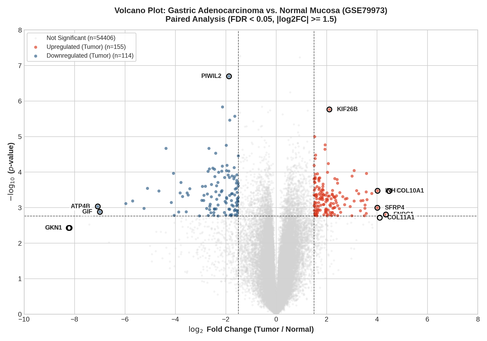

# Transcriptomic Microarray Preprocessing & Differential Expression Pipeline

[](https://www.r-project.org/)
[](https://bioconductor.org/)

An automated R pipeline for raw Affymetrix microarray preprocessing, Robust Multi-array Average (RMA) normalization, dynamic probe annotation, and paired linear modeling with empirical Bayes moderation.

---

## Scientific Context

This pipeline was engineered to identify diagnostic and prognostic biomarker signatures in gastric adenocarcinoma from the NCBI Gene Expression Omnibus (GEO) dataset **GSE79973**. The cohort consists of $N = 20$ arrays representing **10 matched patient pairs** of primary gastric adenocarcinoma (`C`) versus adjacent non-cancerous mucosa (`N`).

Analytical findings derived from this pipeline were selected for an **Oral Presentation** at the *Second International Congress of Cancer Genomics (CGC2024)* (Certificate No: 40321102).


---

## Directory Structure

```text
01_transcriptomics_microarray/
├── README.md
├── normalize_affy_geo.R              # Raw archive extraction, RMA, and GEO annotation
├── diff_expr_limma.R                 # Paired eBayes linear modeling and visualization
├── data/
│   ├── .gitkeep                      # Directory for raw CEL archives (e.g., GSE79973_RAW.tar)
│   └── GSE79973_RAW.tar              # Ignored by version control
└── results/
    ├── .gitkeep
    ├── GSE79973_normalized_annotated.tsv # Clean 54,675 x 22 expression matrix
    ├── GSE79973_DEG_limma_results.tsv    # Full eBayes statistical summary table
    ├── volcano_plot_GSE79973.png         # Publication-grade volcano plot
    └── heatmap_top_DEGs_GSE79973.png     # Clustered expression heatmap (top 30 DEGs)
