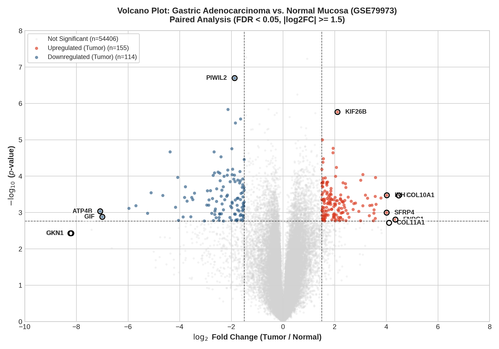
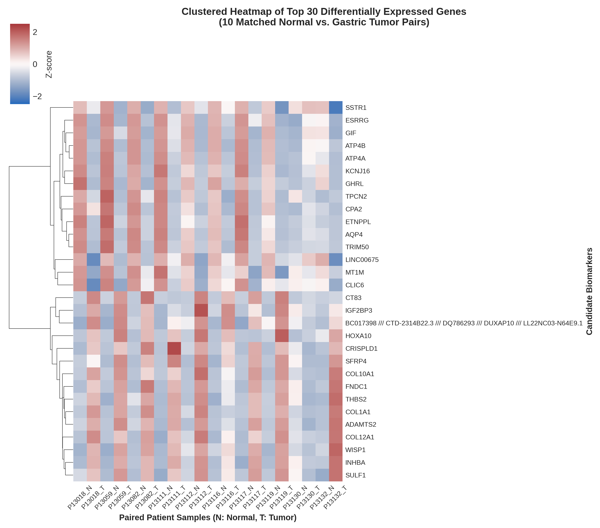

# Computational Biology & Microbial Functional Genomics Toolkit

[](https://opensource.org/licenses/MIT)
[](https://www.python.org/)
[](https://www.r-project.org/)
[](https://bioconductor.org/)

An integrated computational biology repository providing reproducible workflows for **transcriptomic microarray normalization, quality control, and paired differential expression analysis** alongside **high-throughput NCBI BLAST pairwise alignment parsing for microbial adhesin variant discovery**.

---

## Table of Contents
- [Project Architecture](#project-architecture)
- [Module 1: Transcriptomics & Differential Expression](#module-1-transcriptomics--differential-expression)
  - [Overview & Scientific Background](#module-1-overview)
  - [Analytical Workflow](#analytical-workflow)
  - [Candidate Biomarker Discovery](#candidate-biomarker-discovery)
  - [Visualizations](#visualizations)
  - [Usage](#usage-module-1)
- [Module 2: BLAST Sequence & Variant Parsing](#module-2-blast-sequence--variant-parsing)
  - [Overview & Scientific Background](#module-2-overview)
  - [Key Features](#key-features)
  - [Usage & Real Benchmark](#usage-module-2)
- [Environment Setup & Installation](#environment-setup--installation)
- [Conference Citations](#conference-citations)
- [License & Contact](#license--contact)

---

## <a id="project-architecture"></a>Project Architecture

```text
bioinformatics-genomics-toolkit/
├── .gitignore
├── LICENSE
├── README.md
├── environment.yml
│
├── 01_transcriptomics_microarray/
│   ├── README.md
│   ├── normalize_affy_geo.R              # Raw CEL extraction, RMA normalization, probe annotation
│   ├── diff_expr_limma.R                 # Paired limma empirical Bayes modeling and plotting
│   ├── data/
│   │   ├── .gitkeep                      # Raw tar/CEL archives directory (ignored by git)
│   │   └── GSE79973_RAW.tar              # NCBI GEO raw archive
│   └── results/
│       ├── .gitkeep
│       ├── volcano_plot_GSE79973.png     # Paired volcano plot highlighting candidate biomarkers
│       ├── heatmap_top_DEGs_GSE79973.png # Clustered expression heatmap (10 matched pairs)
│       ├── GSE79973_normalized_annotated.tsv # Clean expression matrix (54,675 probe sets x 20 samples)
│       └── GSE79973_DEG_limma_results.tsv    # Empirical Bayes statistical output table
│
└── 02_sequence_variant_parsing/
    ├── README.md
    ├── blast_variant_extractor.py        # CLI parser for NCBI BLAST pairwise reports
    ├── example_data/
    │   └── HPC2_AlpA.txt                 # Clinical H. pylori WGS assembly BLAST alignment report
    └── results/
        ├── .gitkeep
        └── HPC2_AlpA_extracted.fasta     # Standardized in-frame FASTA output with parsed metadata
```

---

## <a id="module-1-transcriptomics--differential-expression"></a>Module 1: Transcriptomics & Differential Expression

### <a id="module-1-overview"></a>Overview & Scientific Background
This module provides a reproducible transcriptomic pipeline for Affymetrix HG-U133 Plus 2.0 microarrays. The pipeline was developed to characterize transcriptional reprogramming and discover diagnostic and prognostic biomarker signatures in gastric adenocarcinoma from NCBI Gene Expression Omnibus (GEO) accession **GSE79973**.

The dataset comprises $N = 20$ arrays representing **10 matched patient pairs** of primary gastric adenocarcinoma (`C`) versus adjacent non-cancerous gastric mucosa (`N`). Findings from this analysis were selected for an **Oral Presentation** at the *Second International Congress of Cancer Genomics (CGC2024)*.

### <a id="analytical-workflow"></a>Analytical Workflow
1. **Raw CEL File Ingestion:** Extracts and loads raw binary `.CEL` files directly from the compressed GEO archive (`GSE79973_RAW.tar`) using the Bioconductor `affy` library.
2. **RMA Normalization:** Executes Robust Multi-array Average (RMA) preprocessing, which includes optical background noise correction, quantile probe-intensity normalization across all 20 arrays, and median-polish probe set summarization ($\log_2$ scale) across 54,675 probe sets.
3. **Platform Feature Annotation:** Queries the GEO platform database dynamically using `GEOquery` to link probe identifiers with official HUGO Gene Symbols and descriptions.
4. **Paired Empirical Bayes Linear Modeling:** Fits a paired linear model using `limma` with the design formula:
   $$\text{Expression} \sim \text{Patient} + \text{Tissue}$$
   This formulation controls for inter-individual patient variability and isolates the true tumor-versus-normal effect. Moderated $t$-statistics and $B$-statistics are calculated via empirical Bayes shrinkage, with Benjamini–Hochberg False Discovery Rate (FDR) adjustments for multiple testing.

### <a id="candidate-biomarker-discovery"></a>Candidate Biomarker Discovery
Applying stringent criteria ($|\log_2\text{FC}| \ge 1.5$ and adjusted $p$-value $< 0.05$) revealed significant tumor-specific dysregulation (155 upregulated and 114 downregulated probe sets):

| Probe ID | Gene Symbol | Regulation | $\log_2$ Fold Change | Paired $p$-value | Adjusted $p$-value | Functional & Clinical Role |
| :--- | :--- | :---: | :---: | :---: | :---: | :--- |
| **`227140_at`** | **INHBA** | Upregulated | **+4.87** | $3.78 \times 10^{-4}$ | $8.07 \times 10^{-3}$ | Activin A subunit; TGF-$\beta$ signaling pathway, cell migration |
| **`217428_s_at`**| **COL10A1** | Upregulated | **+4.48** | $3.42 \times 10^{-4}$ | $7.67 \times 10^{-3}$ | Collagen type X; desmoplasia, extracellular matrix remodeling |
| **`226930_at`** | **FNDC1** | Upregulated | **+4.35** | $1.57 \times 10^{-3}$ | $2.14 \times 10^{-2}$ | Fibronectin type III domain; drives EMT and invasiveness |
| **`37892_at`**  | **COL11A1** | Upregulated | **+4.11** | $1.93 \times 10^{-3}$ | $2.44 \times 10^{-2}$ | Hallmark marker of aggressive cancer-associated fibroblasts (CAFs) |
| **`204051_s_at`**| **SFRP4** | Upregulated | **+4.01** | $1.01 \times 10^{-3}$ | $1.61 \times 10^{-2}$ | Wnt antagonist; associated with invasive tumor stroma |
| **`238222_at`** | **GKN2** | Downregulated | **-8.23** | $3.75 \times 10^{-3}$ | $3.68 \times 10^{-2}$ | Gastrokine 2; mucosal integrity, lost early in carcinogenesis |
| **`220191_at`** | **GKN1** | Downregulated | **-8.19** | $3.74 \times 10^{-3}$ | $3.68 \times 10^{-2}$ | Gastrokine 1; gastric mucosal differentiation suppressor |
| **`207546_at`** | **ATP4B** | Downregulated | **-7.08** | $9.31 \times 10^{-4}$ | $1.53 \times 10^{-2}$ | $\text{H}^+/\text{K}^+$ ATPase subunit; indicates loss of parietal cells |
| **`207033_at`** | **GIF** | Downregulated | **-6.99** | $1.33 \times 10^{-3}$ | $1.92 \times 10^{-2}$ | Gastric intrinsic factor; depletion of specialized mucosal cells |

### <a id="visualizations"></a>Visualizations

#### Paired Volcano Plot
Statistical significance ($-\log_{10} p$-value) plotted against effect size ($\log_2\text{FC}$), highlighting candidate diagnostic and therapeutic markers:

<p align="center">
  
</p>

#### Clustered Expression Heatmap
Row-standardized Z-scores of the top 30 candidate biomarkers across 10 matched pairs (interleaved normal `N` and tumor `T` samples):

<p align="center">
  
</p>

### <a id="usage-module-1"></a>Usage
From the repository root:

```bash
# Step 1: Execute CEL archive extraction, RMA normalization, and dynamic annotation
Rscript 01_transcriptomics_microarray/normalize_affy_geo.R GSE79973

# Step 2: Run paired linear modeling and generate volcano & heatmap plots
Rscript 01_transcriptomics_microarray/diff_expr_limma.R
```

---

## <a id="module-2-blast-sequence--variant-parsing"></a>Module 2: BLAST Sequence & Variant Parsing

### <a id="module-2-overview"></a>Overview & Scientific Background
This module provides a command-line Python parser for NCBI pairwise BLAST reports (Format 0). It automates multi-block sequence assembly, extracts alignment coordinates, manages indel gaps, and formats outputs into standardized FASTA files.

The pipeline was developed during genomic research investigating outer membrane protein (OMP) adhesin diversification across 31 clinical *Helicobacter pylori* whole-genome sequencing (WGS) isolates from Iranian patients. Contigs were screened against reference strains MT5135 (*alpA*, *alpB*, *babA*, *sabA*) and 26695 (*hopZ*) using $\ge 95\%$ coverage and $\ge 85\%$ sequence identity cutoffs.

#### Genomic Discovery Output
This automated parsing engine supported the discovery and assembly of **76 novel non-redundant alleles** registered in NCBI GenBank:
* **`alpA`**: 30 novel alleles identified
* **`alpB`**: 27 novel alleles identified
* **`hopZ`**: 28 novel alleles identified
* **`sabA`**: 21 novel alleles identified
* **`babA`**: 5 novel alleles identified

These findings were presented at the *6th International & 18th Iranian Genetics Congress (GC2024)* (Abstract G-1201).

### <a id="key-features"></a>Key Features
* **Multi-Block Regex Extraction:** Parses and concatenates discontinuous `Sbjct` sequence blocks across multi-page pairwise alignments.
* **Header Metadata Harvesting:** Automatically parses target contig identifiers (`>ID`), genomic range coordinates (`Range: Start to End`), strand orientations (`Plus/Plus` or `Plus/Minus`), and percentage identities.
* **Indel Management (`--strip-gaps`):** Detects and removes alignment gap characters (`-`) to produce an uninterrupted sequence suitable for translation and multiple sequence alignment.
* **NCBI-Compliant FASTA Output:** Generates formatted FASTA records with detailed structural headers.

### <a id="usage-module-2"></a>Usage & Real Benchmark
Test the parser on the provided clinical isolate whole-genome alignment report (`HPC2_AlpA.txt`, 148-contig draft assembly):

```bash
python 02_sequence_variant_parsing/blast_variant_extractor.py \
  -i 02_sequence_variant_parsing/example_data/HPC2_AlpA.txt \
  -o 02_sequence_variant_parsing/results/HPC2_AlpA_extracted.fasta \
  --gene "AlpA" \
  --strip-gaps
```

#### Raw BLAST Alignment Input Snippet (`example_data/HPC2_AlpA.txt`)
```text
>142495
Sequence ID: Query_3405 Length: 18945
Range 1: 15373 to 16929

Score:2361 bits(1278), Expect:0.0, 
Identities:1471/1564(94%),  Gaps:14/1564(0%), Strand: Plus/Plus

Query  1      ATGATAAAGAAGAATAGAACGCTGTTTCTTAGTCTAGCCCTTTGCGCTAGCATAAGTTAT  60
              ||||||||||| ||||||||||||||||||||||||||||||||||||||||||||||||
Sbjct  15373  ATGATAAAGAAAAATAGAACGCTGTTTCTTAGTCTAGCCCTTTGCGCTAGCATAAGTTAT  15432
```

#### Standardized FASTA Output (`results/HPC2_AlpA_extracted.fasta`)
```fasta
>AlpA_142495 | Range=15373..16929 | Strand=Plus/Plus | Identity=1471/1564 (94%) | Length=1550bp
ATGATAAAGAAAAATAGAACGCTGTTTCTTAGTCTAGCCCTTTGCGCTAGCATAAGTTATGCCGAAGATGATGGAGGGTTTTTCACCG
TCGGTTATCAGCTTGGGCAAGTCATGCAAGATGTCCAAAACCCAGGCGGCGCTAAAAGCGACGAACTCGCTAGAGAGCTTAACGCTGA
TGTAACGAACAACATTTTAAACAACAACACCGGAGGCAATGTCGCAGGGGCGTTGAGTAACGCTTTCTCCCAATACCTTTATTCGCTT
TTAGGGGCGTATCCCACGAAACTCAATAGTAACGATGTGTCCGCGAACGCTCTTTTAAGTGGTGCGGTAGGCAGTGGGACTTGTGCGG
CTGCAGGGACGGCTGGTGGCACATCTCTTAACACTCAAAGCGCTTGCACCGCTGCGGGCTATTACTGGCTCCCTAGCTTGACTGACAG...
```

---

## <a id="environment-setup--installation"></a>Environment Setup & Installation

Clone the repository and build the dedicated Conda environment:

```bash
# Clone repository
git clone https://github.com/AmirShamex/bioinformatics-genomics-toolkit.git
cd bioinformatics-genomics-toolkit

# Create environment from environment.yml
conda env create -f environment.yml

# Activate environment
conda activate compbio-env
```

### `environment.yml` Specification
```yaml
name: compbio-env
channels:
  - conda-forge
  - bioconda
  - defaults
dependencies:
  - python=3.10
  - pip
  - biopython
  - pandas
  - numpy
  - scipy
  - r-base>=4.2.0
  - bioconductor-affy
  - bioconductor-geoquery
  - bioconductor-limma
  - r-tidyverse
  - r-pheatmap
  - r-ggrepel
```

---

## <a id="conference-citations"></a>Conference Citations

If utilizing or adapting these analytical pipelines, please cite the corresponding conference presentations:

1. **Bahrami, B.**, **Shamekhi, S. A.**, & **Tohidfar, M.** (2024, October 23–25). *Unveiling Potential Biomarkers for Gastric Cancer Through Bioinformatics Approaches* [Oral Presentation]. Second International Congress of Cancer Genomics (CGC2024), Tehran, Iran. Certificate No: 40321102.
2. **Najafi Disfani, M. R.**, **Shamekhi, S. A.**, **Razkhaneh, M.**, & **Saniee, P.** (2024, July 7–9). *Identification of novel variants in Hop adhesion gene family in Iranian Helicobacter pylori isolates through whole genome sequencing* [Poster Presentation]. 6th International & 18th Iranian Genetics Congress (GC2024), Shahid Beheshti University, Tehran, Iran. Abstract Code: G-1201.

---

## <a id="license--contact"></a>License & Contact

* **License:** Distributed under the [MIT License](LICENSE).
* **Author:** Seyed Amirhossein Shamekhi
* **Affiliation:** Department of Microbiology and Microbial Biotechnology, Shahid Beheshti University, Tehran, Iran
* **GitHub:** [@AmirShamex](https://github.com/AmirShamex)
* **LinkedIn:** [amirhossein-shamekhi](https://linkedin.com/in/amirshamekhi)
* **Email:** [amirhossein.shamekhi@gmail.com](mailto:amirhshamekhi@gmail.com)
